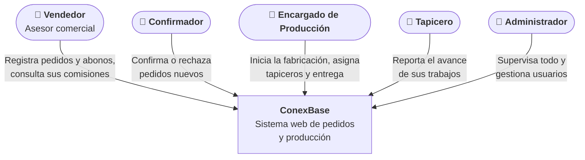

# 3. Contexto y alcance

## Diagrama de contexto (C4 · nivel 1)

ConexBase visto desde afuera: una sola caja, con las personas que lo usan.

No hay sistemas externos: ConexBase no se conecta con bancos, pasarelas de
pago, correo ni otros programas.

## Alcance

| Dentro del alcance | Fuera del alcance |
|---|---|
| Registro de clientes y pedidos con sus productos | Inventario de materiales |
| Abonos (pagos parciales) del cliente | Pasarela de pagos en línea |
| Confirmación o rechazo del pedido | Facturación electrónica |
| Producción por producto y trabajos de tapicería | Nómina general de la empresa |
| Historial de cambios de estado | Tienda en línea para clientes |
| Comisiones de los asesores | Otros negocios distintos a camas y muebles |
| Reportes del día y por periodo | Aplicación móvil nativa |

## Lo que reemplaza

| Antes | Ahora en ConexBase |
|---|---|
| Pedido enviado por WhatsApp | *Crear Pedido* |
| Confirmación por chat con el asesor | *Confirmación*, con motivo si se rechaza |
| Planilla de producción en Excel | *Fabricación* y *Mis Productos* |
| Cálculo de comisiones a mano | *Mis Comisiones* y *Comisiones de Asesores* |
| Resumen del día armado a mano | *Pedidos del Día* y *Consolidado* |
