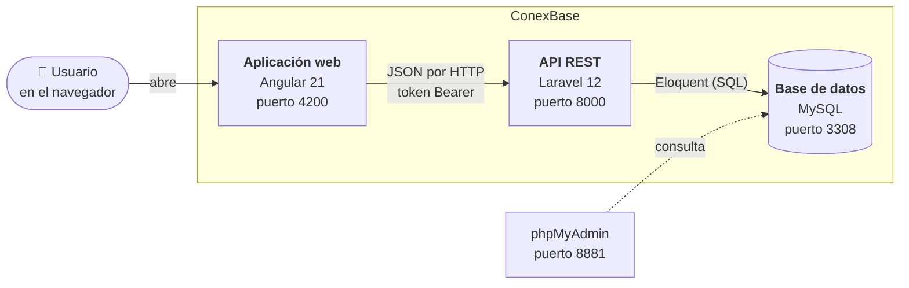
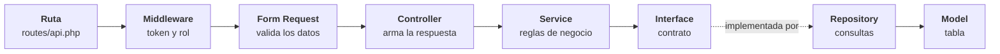
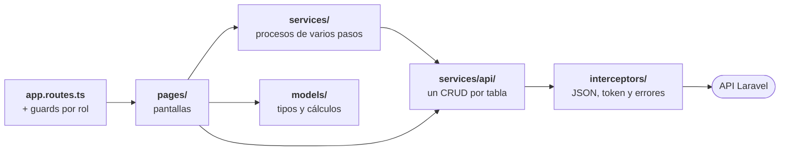

# 5. Vista de bloques

Esta sección muestra **cómo está dividido el sistema** y en qué carpeta vive
cada parte. Va de lo general a lo particular, como hacer zoom en un mapa.

## Contenedores (C4 · nivel 2)

ConexBase tiene tres piezas que se ejecutan por separado, cada una en su
contenedor de Docker, más phpMyAdmin como herramienta de apoyo.



| Contenedor | Carpeta | Responsabilidad |
|---|---|---|
| Aplicación web | `client/` | Pantallas por rol, navegación, procesos de varios pasos y cálculos de reportes y comisiones. |
| API REST | raíz del repositorio (`app/`, `routes/`, `config/`) | Autenticación, permisos, validación de datos y acceso a la base de datos. |
| Base de datos | `database/` (migraciones y seeder) | Guarda la información. |

## Componentes del backend (C4 · nivel 3)

Cada petición atraviesa siempre las mismas capas. **Cada capa tiene una sola
responsabilidad**, así sabes en qué archivo va cada cambio.



| Capa | Carpeta | Ejemplo | Aquí va… |
|---|---|---|---|
| Rutas | `routes/api.php` | `Route::apiResource('clientes', ClienteController::class)` | Una URL nueva y qué roles pueden usarla. |
| Middleware | `app/Http/Middleware/` | `AutenticarConToken`, `RequiereRol` | Reglas que aplican antes de muchas rutas. |
| Validación | `app/Http/Requests/<Entidad>/` | `StoreClienteRequest`, `UpdateClienteRequest` | Qué campos son obligatorios, sus límites y mensajes. |
| Controlador | `app/Http/Controllers/` | `ClienteController` | Recibir, llamar al servicio y responder con `ok()` o `creado()`. **Sin lógica.** |
| Servicio | `app/Services/` | `ClientesService` (hereda de `BaseService`) | Reglas de negocio, validar el ID y lanzar errores. |
| Interfaz | `app/Interfaces/` | `ClientesInterface` (extiende `BaseInterface`) | Qué operaciones ofrece el repositorio. |
| Repositorio | `app/Repositories/` | `ClientesRepository` (hereda de `BaseRepository`) | **Las únicas** consultas a la base de datos. |
| Modelo | `app/Models/` | `Cliente` | Tabla, campos permitidos (`$fillable`), relaciones, `SoftDeletes`. |
| Errores | `app/Exceptions/` + `bootstrap/app.php` | `ResourceNotFoundException` | Errores propios y cómo se convierten en JSON. |
| Enlaces | `app/Providers/AppServiceProvider.php` | `bind(ClientesInterface::class, ClientesRepository::class)` | Qué repositorio usar para cada interfaz. |

!!! tip "Regla práctica"
    Si escribes un `if` de negocio en un **Controller**, muévelo al
    **Service**. Si escribes una consulta en un **Service**, muévela al
    **Repository**.

### Clases base: el código que no se repite

Las 11 entidades hacen lo mismo (listar, ver, crear, actualizar, eliminar),
así que ese código está escrito **una sola vez**:

| Clase base | Qué resuelve | Lo que cada entidad agrega |
|---|---|---|
| `BaseRepository` | `getAll`, `getById`, `create`, `update`, `delete` con Eloquent | Solo recibe su modelo en el constructor. |
| `BaseService` | Las mismas operaciones, más la validación del ID y los errores 404 | Su código (`'CLIENTE'`) y su nombre (`'cliente'`) para los mensajes. |
| `Controller` | `ok()` y `creado()` con el formato único de respuesta | Sus propios mensajes. |

Para cambiar el comportamiento de una sola entidad, el servicio
**sobrescribe** el método y llama a `parent::`. Ejemplo real: `UsuarioService`
sobrescribe `update()` para no borrar la contraseña cuando no se envía una
nueva.

### Entidades

| Entidad | Ruta | Controller | Service | Repository |
|---|---|---|---|---|
| Rol | `/api/roles` | `RolController` | `RolService` | `RolRepository` |
| Usuario | `/api/usuarios` | `UsuarioController` | `UsuarioService` | `UsuarioRepository` |
| Cliente | `/api/clientes` | `ClienteController` | `ClientesService` | `ClientesRepository` |
| Categoría | `/api/categorias` | `CategoriaController` | `CategoriasService` | `CategoriasRepository` |
| Producto | `/api/productos` | `ProductoController` | `ProductoService` | `ProductosRepository` |
| Pedido | `/api/pedidos` | `PedidoController` | `PedidosService` | `PedidosRepository` |
| Detalle de pedido | `/api/detalle-pedidos` | `DetallePedidoController` | `DetallePedidoService` | `DetallePedidoRepository` |
| Pago | `/api/pagos` | `PagoController` | `PagosService` | `PagosRepository` |
| Producción | `/api/producciones` | `ProduccionController` | `ProduccionService` | `ProduccionRepository` |
| Trabajo de tapicero | `/api/trabajos-tapiceros` | `TrabajosTapicerosController` | `TrabajosTapicerosService` | `TrabajosTapicerosRepository` |
| Historial de pedido | `/api/historial-pedidos` | `HistorialPedidosController` | `HistorialPedidosService` | `HistorialPedidosRepository` |

La autenticación es aparte: `AuthController` → `AuthService` →
`UsuarioRepository` y `TokenAccesoRepository`.

## Componentes del frontend (C4 · nivel 3)



| Carpeta (`client/src/app/`) | Contiene | Ejemplos |
|---|---|---|
| `pages/` | Una carpeta por pantalla (componente + HTML). | `crear-pedido`, `confirmacion`, `fabricacion` |
| `services/api/` | Un servicio por tabla. Cada uno solo declara su `endpoint`; el resto lo hereda de `CrudService<T>`. | `ClientesService`, `PedidosService` |
| `services/` | Procesos que combinan varias tablas. | `CrearPedidoService`, `CambioEstadoService`, `PedidosFacadeService`, `AuthService` |
| `models/` | Interfaces de cada tabla y **funciones puras** con sus pruebas. | `pedido.model.ts`, `comision.model.ts` (`calcularComisiones`) |
| `guards/` | Quién puede entrar a cada ruta. | `authGuard`, `rolesPermitidos(...)` |
| `interceptors/` | Lo que se hace con **todas** las peticiones HTTP. | `apiHeadersInterceptor`, `authInterceptor`, `errorInterceptor` |
| `config/` | Datos de configuración de la aplicación. | `roles.ts`, `navigation.ts` (menú por rol), `comisiones.ts` (5 %) |
| `components/` | Piezas visuales reutilizables. | `estado-badge`, `stat-card`, `page-header` |
| `layouts/` | El marco con menú lateral que envuelve las pantallas. | `main-layout` |
| `utils/` | Funciones de apoyo. | `fecha.ts`, `format.ts` |
| `testing/` | Datos de ejemplo para las pruebas. | `datos-prueba.ts` |

### Pantallas

| Ruta (`/dashboard/…`) | Carpeta en `pages/` | Roles |
|---|---|---|
| *(inicio)* Panel General | `dashboard` | Administrador |
| `crear-pedido` | `crear-pedido` | Vendedor |
| `mis-pedidos` | `pedidos` (con `alcance: 'propios'`) | Vendedor |
| `mis-comisiones` | `mis-comisiones` | Vendedor |
| `ventas-confirmadas` | `pedidos` (filtrada por estado) | Vendedor |
| `ventas` | `pedidos` (con `alcance: 'todos'`) | Administrador |
| `confirmacion` | `confirmacion` | Administrador, Confirmador |
| `fabricacion` | `fabricacion` | Administrador, Producción |
| `tapicero` | `mis-productos` | Tapicero |
| `pedidos-del-dia` | `pedidos-del-dia` | Todos menos Tapicero |
| `consolidado` | `consolidado` | Todos menos Tapicero |
| `comisiones-asesores` | `comisiones-asesores` | Administrador |
| `usuarios` | `usuarios` | Administrador |

La misma pantalla `pedidos` sirve para tres rutas distintas: la ruta le pasa
datos (`data`) que cambian el título, el alcance y los estados que muestra.

## Estructura de carpetas

```text
ConexBase/
├── app/                      ← BACKEND (Laravel)
│   ├── Exceptions/           errores propios (404, 422, 401, 403)
│   ├── Http/Controllers/     reciben la petición y responden JSON
│   ├── Http/Middleware/      AutenticarConToken y RequiereRol
│   ├── Http/Requests/        validaciones (Store y Update por entidad)
│   ├── Interfaces/           contratos de los repositorios
│   ├── Models/               modelos Eloquent
│   ├── Providers/            enlaces interfaz → repositorio y límite de login
│   ├── Repositories/         consultas a la base de datos
│   ├── Services/             reglas de negocio
│   └── Support/Roles.php     nombres de los roles
├── bootstrap/app.php         alias de middleware y formato de los errores
├── config/                   configuración (app, cors, scribe…)
├── database/
│   ├── migrations/           estructura de las tablas (01_ a 12_)
│   └── seeders/              datos de prueba
├── routes/api.php            todas las rutas y sus permisos
├── client/                   ← FRONTEND (Angular)
│   ├── proxy.conf.js         reenvía /api al backend en desarrollo
│   └── src/app/              (ver la tabla de arriba)
├── docker/entrypoint.sh      arranque automático de la API
├── docker-compose.yml        los 4 contenedores
├── docs/                     ← esta documentación
└── mkdocs.yml                configuración de este sitio
```
