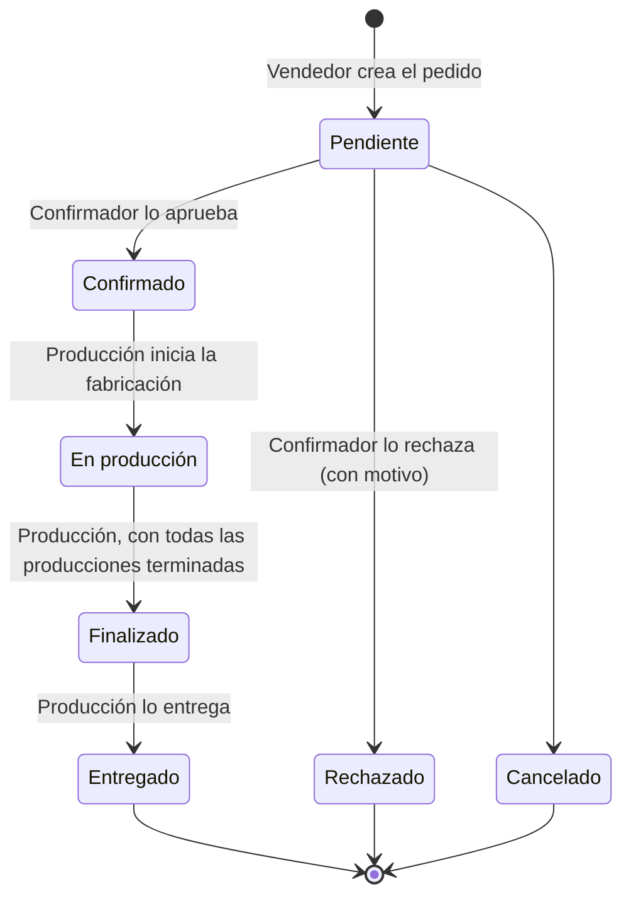
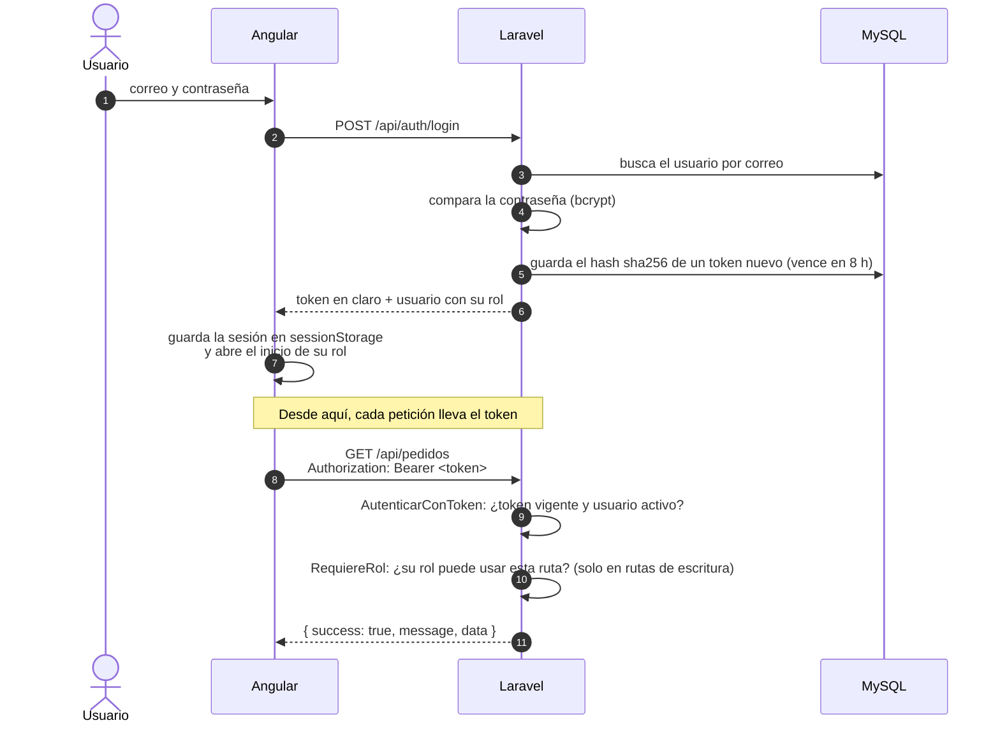
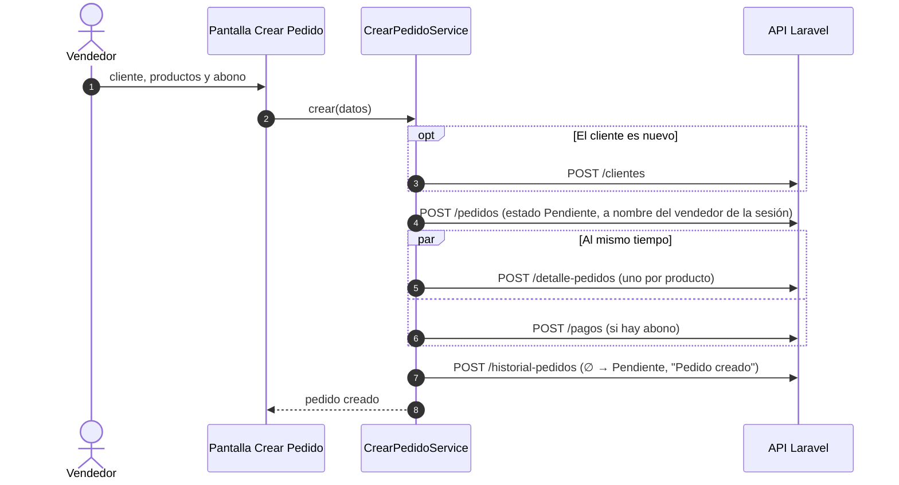
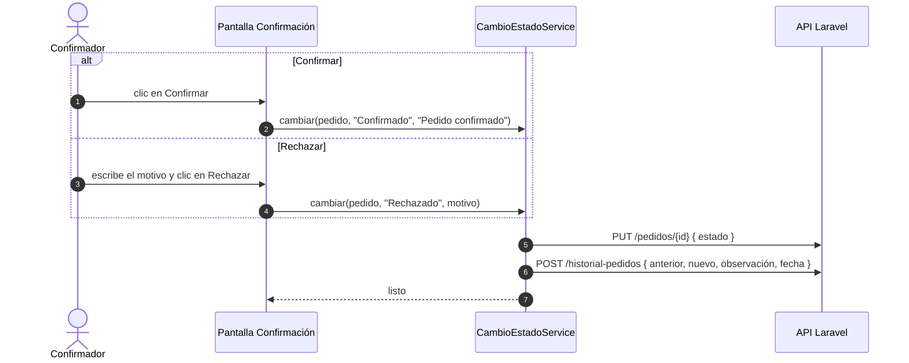
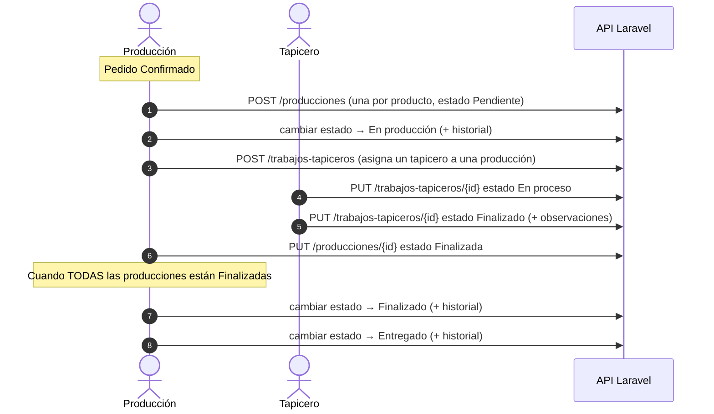
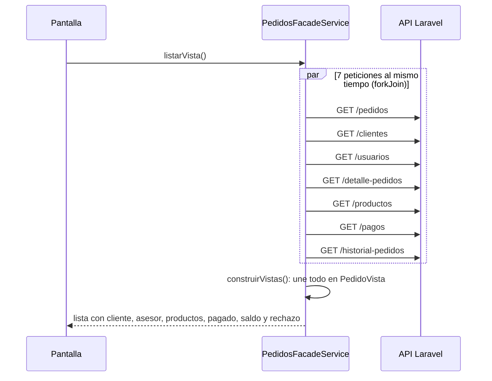

# 6. Vista de ejecución

Cómo colaboran las partes del sistema en los procesos reales, paso a paso.
Los diagramas de secuencia se leen **de arriba hacia abajo**: cada flecha es
un mensaje entre dos participantes.

## Ciclo de vida del pedido

| Estado | Quién lo pone | Pantalla |
|---|---|---|
| Pendiente | Vendedor (al crear) | Crear Pedido |
| Confirmado / Rechazado | Confirmador o Administrador | Confirmación |
| En producción | Producción o Administrador | Fabricación → *Iniciar producción* |
| Finalizado | Producción o Administrador | Fabricación → *Marcar finalizado* (solo si todas sus producciones están terminadas) |
| Entregado | Producción o Administrador | Fabricación → *Marcar entregado* |
| Cancelado | Hoy solo existe en los datos de prueba; no hay botón para cancelar | — |

**Cada cambio de estado** crea una fila en `historial_pedidos` con el estado
anterior, el nuevo, quién lo hizo, cuándo y la observación (en un rechazo,
la observación es el motivo). De ahí salen *Pedidos del Día*, las fechas de
entrega de las comisiones y el motivo que ve el vendedor.

## Iniciar sesión y hacer una petición

Si el token vence o es inválido, la API responde **401**: el
`errorInterceptor` cierra la sesión y lleva al usuario al login.

## Crear un pedido (Vendedor)

`CrearPedidoService` arma el pedido completo usando los CRUD de la API, en
este orden:

El total lo calcula el frontend con el precio de cada producto
(`CrearPedidoService.total()`).

!!! warning "Sin transacción"
    Son varias peticiones independientes. Si una falla a mitad de camino,
    las anteriores ya quedaron guardadas. Ver
    [Riesgos y deuda técnica](11-riesgos.md).

## Confirmar o rechazar (Confirmador)

Las dos acciones usan `CambioEstadoService.cambiar()`, que siempre hace dos
pasos:

El vendedor ve el motivo del rechazo en *Mis Pedidos*: se lee de la última
entrada del historial con estado *Rechazado*.

## Fabricación (Producción y Tapicero)

Hay tres niveles de estado distintos, cada uno en su tabla:

| Tabla | Estados | Quién los cambia |
|---|---|---|
| `pedidos` | Pendiente, Confirmado, En producción, Finalizado, Entregado, Rechazado, Cancelado | Confirmador y Producción |
| `producciones` (una por producto del pedido) | Pendiente, En proceso, Finalizada | Producción |
| `trabajos_tapiceros` (uno por tapicero asignado) | Pendiente, En proceso, Finalizado | Tapicero |

## Comisiones

No hay una tabla de comisiones: se **calculan** cada vez que se abre la
pantalla, con la función pura `calcularComisiones()` de
`client/src/app/models/comision.model.ts`.

| Situación del pedido | Comisión |
|---|---|
| **Entregado** | **Ganada**: 5 % del total. Cuenta en el mes de la entrega (fecha tomada del historial). |
| Confirmado, En producción o Finalizado | **Por ganar**: se muestra, pero aún no se suma a lo ganado. |
| Pendiente, Rechazado o Cancelado | No genera comisión. |

El porcentaje y los estados están en `client/src/app/config/comisiones.ts`.

## Cargar una pantalla con datos de varias tablas

La API devuelve cada tabla por separado (un pedido trae `cliente_id`, no el
cliente). Por eso `PedidosFacadeService` pide **7 recursos en paralelo** y
los une en el frontend:

