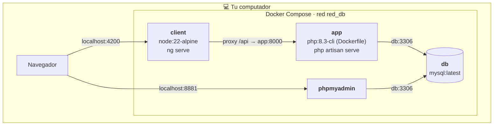

# 7. Despliegue

Hoy ConexBase se ejecuta en el **entorno de desarrollo** de cada integrante
con Docker Compose. Todavía no hay un servidor de producción.

## Contenedores

| Servicio | Imagen | Puerto en tu PC → contenedor | Qué hace al arrancar |
|---|---|---|---|
| `app` | `Dockerfile` de la raíz (PHP 8.3 + Composer) | 8000 → 8000 | Ejecuta `docker/entrypoint.sh`: `.env`, clave, migraciones, seeder y servidor. Espera a que `db` esté sano. |
| `client` | `node:22-alpine` | 4200 → 4200 | `npm install` y `npm start` (Angular con recarga automática). |
| `db` | `mysql:latest` | 3308 → 3306 | Crea la base de datos `ConexBase` con usuario `root` y clave `1234`. |
| `phpmyadmin` | `phpmyadmin:latest` | 8881 → 80 | Interfaz web para ver la base de datos. |

Dentro de la red de Docker los servicios se llaman por su nombre: la API se
conecta a `db:3306`, y Angular reenvía `/api` a `http://app:8000` (variable
`API_PROXY_TARGET`). Desde tu computador se usan los puertos de la izquierda.

## Volúmenes

| Volumen | Guarda | Se borra con |
|---|---|---|
| `mysql_data` | Los datos de MySQL | `docker compose down -v` |
| `vendor` | Las dependencias de Composer | `docker compose down -v` |
| `client_node_modules` | Las dependencias de npm | `docker compose down -v` |

El código (`.` y `./client`) se monta directamente desde tu carpeta: lo que
guardas en el editor se refleja al instante en los contenedores.

## Variables de entorno (`.env`)

Se crea solo, copiando `.env.example`. **Nunca se sube al repositorio.**

| Variable | Valor en desarrollo | Para qué sirve |
|---|---|---|
| `APP_KEY` | se genera sola | Clave de cifrado de Laravel. |
| `APP_DEBUG` | `true` | Muestra el detalle de los errores. En producción, `false`. |
| `APP_TIMEZONE` | `America/Bogota` | Zona horaria ([ADR-0004](../decisiones/0004-zona-horaria-bogota.md)). |
| `DB_HOST`, `DB_PORT` | `db`, `3306` | Dónde está MySQL (el nombre del servicio de Docker). |
| `DB_DATABASE`, `DB_USERNAME`, `DB_PASSWORD` | `ConexBase`, `root`, `1234` | Credenciales de MySQL; coinciden con `docker-compose.yml`. |
| `SESSION_DRIVER`, `CACHE_STORE` | `file` | La API no usa sesiones de navegador. |
| `CORS_ALLOWED_ORIGINS` | `http://localhost:4200,…` | Qué páginas pueden llamar a la API desde el navegador. |

## Configuración del frontend

| Archivo | `apiUrl` | Se usa en |
|---|---|---|
| `client/src/environments/environment.development.ts` | `/api` (pasa por el proxy) | `npm start` |
| `client/src/environments/environment.ts` | `https://api.tu-dominio.com/api` | `npm run build` (producción) |

En producción el frontend **rechaza** cualquier llamada a la API que no use
HTTPS (`apiHeadersInterceptor`).

## Antes de llevarlo a producción

Pendientes para cuando exista un servidor real:

- [ ] Cambiar `apiUrl` de `environment.ts` por el dominio real.
- [ ] `APP_ENV=production` y `APP_DEBUG=false`.
- [ ] Usuario de MySQL propio con contraseña segura (no `root` / `1234`).
- [ ] No ejecutar el seeder de datos de prueba.
- [ ] Servir la API con un servidor web (Nginx o Apache con PHP-FPM) en lugar de `php artisan serve`.
- [ ] Servir el frontend compilado (`npm run build`, carpeta `client/dist/`).
- [ ] HTTPS en los dos.
