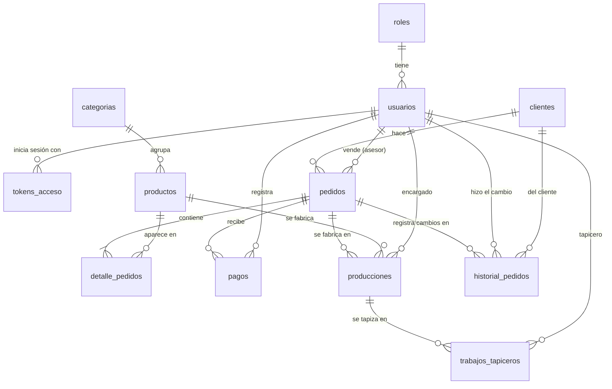

# Base de datos

MySQL, base de datos `ConexBase`, con **12 tablas**. La estructura la definen
las migraciones de `database/migrations/` (`01_roles.php` a
`12_tokens_acceso.php`): **ante cualquier diferencia con esta página, mandan
las migraciones**.

Para verla con tus propios ojos: phpMyAdmin en <http://localhost:8881>
(servidor `db`, usuario `root`, clave `1234`).

## Diagrama entidad-relación

Se lee así: `pedidos ||--|{ detalle_pedidos` = un pedido tiene **uno o
más** detalles; `||--o{` = **cero o más**.

## Convenciones

| Convención | Detalle |
|---|---|
| Llave primaria | `id`, `BIGINT UNSIGNED` autoincremental. |
| Llaves foráneas | `<tabla en singular>_id`, con `constrained()` y `onDelete('cascade')`. |
| Fechas de control | `created_at` y `updated_at` en todas las tablas. |
| Borrado lógico | `deleted_at` en todas las tablas excepto `tokens_acceso` ([ADR-0003](../decisiones/0003-borrado-logico.md)). Un registro con `deleted_at` lleno está eliminado. |
| Dinero | `DECIMAL(12,2)`. |
| `estado` | `BOOLEAN` (activo o inactivo) en roles, usuarios, clientes, categorías y productos. `VARCHAR(50)` (nombre del estado) en pedidos, producciones y trabajos. |

En las tablas de abajo no se repiten `id`, `created_at`, `updated_at` ni
`deleted_at`.

## Diccionario de datos

### Usuarios y acceso

#### `roles`

Roles del sistema. Sus nombres deben coincidir con `app/Support/Roles.php`.

| Campo | Tipo | Nulo | Restricción | Descripción |
|---|---|---|---|---|
| `nombre` | VARCHAR(255) | No | Único | Administrador, Vendedor, Confirmador, Encargado de Producción o Tapicero. |
| `descripcion` | VARCHAR(255) | Sí | | Para qué sirve el rol. |
| `estado` | BOOLEAN | No | Por defecto `true` | Activo o inactivo. |

#### `usuarios`

Personas que entran al sistema.

| Campo | Tipo | Nulo | Restricción | Descripción |
|---|---|---|---|---|
| `documento` | VARCHAR(20) | No | Único | Documento de identidad. |
| `nombre` | VARCHAR(100) | No | | Nombres. |
| `apellido` | VARCHAR(100) | No | | Apellidos. |
| `correo` | VARCHAR(150) | No | Único | Con este correo inicia sesión. |
| `password` | VARCHAR(255) | No | | Hash bcrypt. Nunca la contraseña en claro. |
| `rol_id` | BIGINT | No | FK → `roles` | Su rol. |
| `estado` | BOOLEAN | No | Por defecto `true` | Si es `false`, no puede iniciar sesión. |

#### `tokens_acceso`

Sesiones abiertas ([ADR-0002](../decisiones/0002-token-propio.md)). No tiene borrado lógico: al cerrar sesión el token se borra.

| Campo | Tipo | Nulo | Restricción | Descripción |
|---|---|---|---|---|
| `usuario_id` | BIGINT | No | FK → `usuarios` | Dueño de la sesión. |
| `token` | CHAR(64) | No | Único | Hash sha256 del token (no el token). |
| `expira_en` | DATETIME | No | | Vencimiento: 8 horas después del login. |
| `ultimo_uso_en` | DATETIME | Sí | | Última petición hecha con el token. |

### Catálogo

#### `clientes`

| Campo | Tipo | Nulo | Restricción | Descripción |
|---|---|---|---|---|
| `documento` | VARCHAR(20) | No | Único | Documento de identidad. |
| `nombre` | VARCHAR(150) | No | | Nombre completo. |
| `telefono` | VARCHAR(20) | No | | Teléfono de contacto. |
| `correo` | VARCHAR(150) | No | Único | Correo electrónico. |
| `direccion` | VARCHAR(255) | Sí | | Dirección de entrega. |
| `estado` | BOOLEAN | No | Por defecto `true` | Activo o inactivo. |

#### `categorias`

| Campo | Tipo | Nulo | Restricción | Descripción |
|---|---|---|---|---|
| `nombre` | VARCHAR(100) | No | Único | Ej.: Sala, Sillas, Mesas. |
| `descripcion` | TEXT | Sí | | |
| `estado` | BOOLEAN | No | Por defecto `true` | Activa o inactiva. |

#### `productos`

| Campo | Tipo | Nulo | Restricción | Descripción |
|---|---|---|---|---|
| `nombre` | VARCHAR(150) | No | | Ej.: Sofá 3 puestos. |
| `descripcion` | TEXT | Sí | | |
| `precio` | DECIMAL(12,2) | No | | Precio de venta actual. |
| `categoria_id` | BIGINT | No | FK → `categorias` | Su categoría. |
| `estado` | BOOLEAN | No | Por defecto `true` | Si se puede vender. |

### Ventas

#### `pedidos`

La fecha del pedido es `created_at`.

| Campo | Tipo | Nulo | Restricción | Descripción |
|---|---|---|---|---|
| `cliente_id` | BIGINT | No | FK → `clientes` | Cliente que compra. |
| `usuario_id` | BIGINT | No | FK → `usuarios` | Asesor que lo vendió (el de la comisión). |
| `estado` | VARCHAR(50) | No | | Pendiente, Confirmado, En producción, Finalizado, Entregado, Rechazado o Cancelado. |
| `total` | DECIMAL(12,2) | No | | Suma de los subtotales de sus detalles. |

#### `detalle_pedidos`

Un renglón por producto del pedido.

| Campo | Tipo | Nulo | Restricción | Descripción |
|---|---|---|---|---|
| `pedido_id` | BIGINT | No | FK → `pedidos` | |
| `producto_id` | BIGINT | No | FK → `productos` | |
| `cantidad` | INT UNSIGNED | No | | Unidades. |
| `precio_unitario` | DECIMAL(12,2) | No | | Precio **al momento de la venta** (no cambia si después cambia el precio del producto). |
| `subtotal` | DECIMAL(12,2) | No | | `cantidad × precio_unitario`. |

#### `pagos`

Abonos del cliente a un pedido.

| Campo | Tipo | Nulo | Restricción | Descripción |
|---|---|---|---|---|
| `pedido_id` | BIGINT | No | FK → `pedidos` | |
| `usuario_id` | BIGINT | No | FK → `usuarios` | Quién registró el pago. |
| `monto` | DECIMAL(12,2) | No | | Valor pagado. |
| `metodo` | VARCHAR(50) | No | | Efectivo, Transferencia, etc. |
| `fecha_pago` | DATE | No | | Día del pago. |
| `comprobante` | VARCHAR(255) | Sí | | Referencia del soporte. |

#### `historial_pedidos`

Un registro por cada cambio de estado de un pedido.

| Campo | Tipo | Nulo | Restricción | Descripción |
|---|---|---|---|---|
| `pedido_id` | BIGINT | No | FK → `pedidos` | |
| `usuario_id` | BIGINT | No | FK → `usuarios` | Quién hizo el cambio. |
| `cliente_id` | BIGINT | No | FK → `clientes` | Cliente del pedido. |
| `estado_anterior` | VARCHAR(50) | Sí | | Vacío cuando el pedido se crea. |
| `estado_nuevo` | VARCHAR(50) | Sí | | Estado al que pasó. |
| `observacion` | TEXT | Sí | | Comentario; en un rechazo, el **motivo**. |
| `fecha` | DATETIME | No | | Fecha y hora del cambio (hora de Colombia). |

### Producción

#### `producciones`

Fabricación de un producto de un pedido. Se crea una por cada producto al iniciar la producción.

| Campo | Tipo | Nulo | Restricción | Descripción |
|---|---|---|---|---|
| `pedido_id` | BIGINT | No | FK → `pedidos` | |
| `producto_id` | BIGINT | No | FK → `productos` | Qué se fabrica. |
| `usuario_id` | BIGINT | No | FK → `usuarios` | Encargado de producción. |
| `fecha_inicio` | DATE | No | | |
| `fecha_fin` | DATE | Sí | | Se llena al terminar. |
| `estado` | VARCHAR(50) | No | | Pendiente, En proceso o Finalizada. |
| `observaciones` | VARCHAR(255) | Sí | | Notas del avance. |

#### `trabajos_tapiceros`

Trabajo asignado a un tapicero sobre una producción.

| Campo | Tipo | Nulo | Restricción | Descripción |
|---|---|---|---|---|
| `produccion_id` | BIGINT | No | FK → `producciones` | |
| `usuario_id` | BIGINT | No | FK → `usuarios` | Tapicero asignado. |
| `descripcion` | TEXT | No | | Qué hay que hacer. |
| `fecha_inicio` | DATE | No | | Fecha de asignación. |
| `fecha_fin` | DATE | Sí | | Se llena al terminar. |
| `estado` | VARCHAR(50) | No | | Pendiente, En proceso o Finalizado. |
| `observaciones` | VARCHAR(255) | Sí | | Notas del tapicero. |

## Cambiar la estructura

Nunca edites una migración que ya existe: crea una nueva. Ver
[Agregar un campo](../guias/agregar-campo.md) y
[Crear un recurso nuevo](../guias/nuevo-recurso.md). Después de cambiar la
estructura, actualiza esta página.
