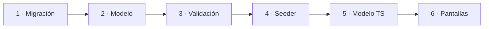

# Agregar un campo a una tabla

**Ejemplo:** el negocio pide guardar el **barrio** de cada cliente.

El cambio toca 6 archivos, siempre en el mismo orden: **de la base de datos
hacia la pantalla**.



## Backend

### 1. Crear una migración

!!! warning "No edites `03_clientes.php`"
    Esa migración ya se ejecutó en la base de datos de tus compañeros. Un
    cambio en ella no se aplicaría. Crea una **nueva**.

```bash
docker compose exec app php artisan make:migration add_barrio_to_clientes_table
```

```php title="database/migrations/xxxx_add_barrio_to_clientes_table.php"
public function up(): void
{
    Schema::table('clientes', function (Blueprint $table) {
        $table->string('barrio', 100)->nullable()->after('direccion');
    });
}

public function down(): void
{
    Schema::table('clientes', function (Blueprint $table) {
        $table->dropColumn('barrio');
    });
}
```

Usa `nullable()` si los registros que ya existen no tienen ese dato.

### 2. Permitir el campo en el modelo

```php title="app/Models/Cliente.php" hl_lines="7"
protected $fillable = [
    'documento',
    'nombre',
    'telefono',
    'correo',
    'direccion',
    'barrio',
    'estado',
];
```

Si no lo agregas aquí, Laravel **ignora el campo sin avisar** al guardar.

### 3. Validar el campo

En **los dos** archivos de `app/Http/Requests/Cliente/`:
`StoreClienteRequest.php` (crear) y `UpdateClienteRequest.php` (editar).

```php
'barrio' => ['nullable', 'string', 'max:100'],
```

Y su mensaje en español dentro de `messages()`:

```php
'barrio.max' => 'El barrio no puede tener más de 100 caracteres.',
```

### 4. Datos de prueba (opcional)

Agrega `'barrio' => 'Kennedy'` a los clientes de
`database/seeders/DatabaseSeeder.php`.

## Frontend

### 5. Agregar el campo al modelo de TypeScript

```ts title="client/src/app/models/cliente.model.ts" hl_lines="7"
export interface Cliente extends RegistroBase {
  documento: string;
  nombre: string;
  telefono: string;
  correo: string;
  direccion: string | null;
  barrio: string | null;
  estado: Activo;
}
```

Al guardar, TypeScript marcará en rojo los lugares donde se crea un
`Cliente` sin el campo nuevo. Así encuentras qué más debes actualizar.

### 6. Mostrarlo en las pantallas

| Pantalla | Archivo | Qué hacer |
|---|---|---|
| Crear Pedido | `pages/crear-pedido/crear-pedido.component.ts` y `.html` | Agregar `barrio` al formulario del cliente y a los datos que se envían. |
| Mis Pedidos / Ventas | `pages/pedidos/pedidos.component.html` | Mostrarlo junto a la dirección. |
| Confirmación | `pages/confirmacion/confirmacion.component.html` | Mostrarlo en los datos de entrega. |

!!! tip "¿Cómo encuentro todas las pantallas que usan un campo?"
    Busca un campo vecino en todo el frontend:
    `grep -rn "direccion" client/src/app` (o con la búsqueda de VS Code).

## Probar el cambio

```bash
docker compose exec app php artisan migrate      # aplica la migración nueva
docker compose exec client npm test              # pruebas del frontend
```

Luego crea un pedido con un cliente nuevo y revisa en phpMyAdmin que el
barrio quedó guardado.

## Checklist antes del commit

- [ ] Migración **nueva**, con `up()` y `down()`
- [ ] Campo en `$fillable`
- [ ] Reglas en Store **y** Update, con mensaje en español
- [ ] Interfaz de TypeScript actualizada
- [ ] Pantallas actualizadas
- [ ] [Diccionario de datos](../datos/index.md) actualizado
- [ ] `php artisan scribe:generate` para actualizar la documentación de la API
