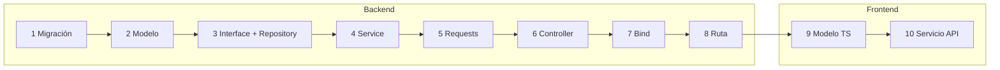

# Crear un recurso nuevo (tabla + CRUD)

**Ejemplo:** la empresa quiere registrar sus **proveedores** de telas y
espumas.

Un recurso nuevo recorre **todas** las capas del backend
([ADR-0001](../decisiones/0001-arquitectura-en-capas.md)). Gracias a las
clases base, casi todos los archivos son cortos. Copia los de una entidad
parecida (aquí, `Cliente` o `Categoria`) y cambia los nombres.



## Backend

### 1. Migración

```bash
docker compose exec app php artisan make:migration create_proveedores_table
```

```php title="database/migrations/xxxx_create_proveedores_table.php"
public function up(): void
{
    Schema::create('proveedores', function (Blueprint $table) {
        $table->id();
        $table->string('nit', 20)->unique();
        $table->string('nombre', 150);
        $table->string('telefono', 20)->nullable();
        $table->boolean('estado')->default(true);
        $table->timestamps();
        $table->softDeletes();          // borrado lógico, siempre
    });
}

public function down(): void
{
    Schema::dropIfExists('proveedores');
}
```

Si la tabla depende de otra, usa
`$table->foreignId('categoria_id')->constrained('categorias');`.

### 2. Modelo

```php title="app/Models/Proveedor.php"
<?php

namespace App\Models;

use Illuminate\Database\Eloquent\Model;
use Illuminate\Database\Eloquent\SoftDeletes;

class Proveedor extends Model
{
    use SoftDeletes;

    protected $table = 'proveedores';   // Laravel pluraliza en inglés: hay que decírselo

    protected $fillable = ['nit', 'nombre', 'telefono', 'estado'];

    protected $casts = ['estado' => 'boolean'];
}
```

### 3. Interfaz y repositorio

```php title="app/Interfaces/ProveedoresInterface.php"
<?php

namespace App\Interfaces;

interface ProveedoresInterface extends BaseInterface
{
}
```

```php title="app/Repositories/ProveedoresRepository.php"
<?php

namespace App\Repositories;

use App\Interfaces\ProveedoresInterface;
use App\Models\Proveedor;

class ProveedoresRepository extends BaseRepository implements ProveedoresInterface
{
    public function __construct(Proveedor $model)
    {
        parent::__construct($model);
    }
}
```

Las consultas especiales (por ejemplo, buscar por NIT) van como métodos
nuevos aquí y se declaran en la interfaz.

### 4. Servicio

```php title="app/Services/ProveedoresService.php"
<?php

namespace App\Services;

use App\Interfaces\ProveedoresInterface;

class ProveedoresService extends BaseService
{
    public function __construct(ProveedoresInterface $repository)
    {
        parent::__construct($repository);
    }

    protected function codigo(): string      // → error PROVEEDOR_NOT_FOUND
    {
        return 'PROVEEDOR';
    }

    protected function sustantivo(): string  // → "El proveedor no existe."
    {
        return 'proveedor';
    }
}
```

Si la entidad es femenina ("la categoría"), sobrescribe también
`femenino()` para que devuelva `true`.

### 5. Validaciones

Crea `app/Http/Requests/Proveedor/StoreProveedorRequest.php` y
`UpdateProveedorRequest.php`. En el de actualizar, los campos van con
`sometimes` y la regla `unique` ignora el propio registro:

=== "Store"

    ```php
    public function rules(): array
    {
        return [
            'nit'      => ['required', 'string', 'max:20', 'unique:proveedores,nit'],
            'nombre'   => ['required', 'string', 'max:150'],
            'telefono' => ['nullable', 'string', 'max:20'],
            'estado'   => ['sometimes', 'boolean'],
        ];
    }

    public function messages(): array
    {
        return [
            'nit.required'    => 'El NIT es obligatorio.',
            'nit.unique'      => 'Ya existe un proveedor con ese NIT.',
            'nombre.required' => 'El nombre es obligatorio.',
        ];
    }
    ```

=== "Update"

    ```php
    public function rules(): array
    {
        return [
            'nit'      => ['sometimes', 'string', 'max:20', 'unique:proveedores,nit,' . $this->route('proveedore')],
            'nombre'   => ['sometimes', 'string', 'max:150'],
            'telefono' => ['nullable', 'string', 'max:20'],
            'estado'   => ['sometimes', 'boolean'],
        ];
    }
    ```

!!! warning "El nombre del parámetro de la ruta"
    `apiResource('proveedores', …)` llama al parámetro en singular **en
    inglés**: `{proveedore}`. Revisa el nombre real con
    `php artisan route:list --path=api/proveedores`.

### 6. Controlador

```php title="app/Http/Controllers/ProveedorController.php"
<?php

namespace App\Http\Controllers;

use App\Http\Requests\Proveedor\StoreProveedorRequest;
use App\Http\Requests\Proveedor\UpdateProveedorRequest;
use App\Services\ProveedoresService;

/**
 * @group Proveedores
 *
 * Proveedores de telas, espumas y materiales.
 */
class ProveedorController extends Controller
{
    public function __construct(private ProveedoresService $proveedoresService)
    {
    }

    public function index()
    {
        return $this->ok($this->proveedoresService->list(), 'Los proveedores se listaron correctamente.');
    }

    public function store(StoreProveedorRequest $request)
    {
        return $this->creado($this->proveedoresService->store($request->validated()), 'El proveedor se creó correctamente.');
    }

    public function show(int $id)
    {
        return $this->ok($this->proveedoresService->show($id), 'Proveedor consultado correctamente.');
    }

    public function update(UpdateProveedorRequest $request, int $id)
    {
        return $this->ok($this->proveedoresService->update($request->validated(), $id), 'El proveedor se actualizó correctamente.');
    }

    public function destroy($id)
    {
        $this->proveedoresService->destroy($id);

        return $this->ok(null, 'Proveedor eliminado correctamente.');
    }
}
```

El bloque `@group` es para la [documentación de la API](../api/index.md) (Scribe).

### 7. Unir la interfaz con el repositorio

```php title="app/Providers/AppServiceProvider.php → register()"
$this->app->bind(
    \App\Interfaces\ProveedoresInterface::class,
    \App\Repositories\ProveedoresRepository::class
);
```

Si lo olvidas, Laravel responde: *Target [App\Interfaces\ProveedoresInterface] is not instantiable*.

### 8. Rutas con permisos

En `routes/api.php`, dentro del grupo `auth.token`: lectura para todos,
escritura para quien corresponda y eliminar solo para el Administrador.

```php title="routes/api.php"
// Lectura
Route::apiResource('proveedores', ProveedorController::class)->only(['index', 'show']);

// Dentro del grupo del Administrador
Route::apiResource('proveedores', ProveedorController::class)->only(['store', 'update', 'destroy']);
```

Más detalles en [Cambiar permisos](permisos.md).

## Frontend

### 9. Modelo de TypeScript

```ts title="client/src/app/models/proveedor.model.ts"
import { Activo, RegistroBase } from './api.model';

/** Tabla `proveedores` del backend. */
export interface Proveedor extends RegistroBase {
  nit: string;
  nombre: string;
  telefono: string | null;
  estado: Activo;
}
```

Y expórtalo en `client/src/app/models/index.ts`:
`export * from './proveedor.model';`

### 10. Servicio de la API

```ts title="client/src/app/services/api/proveedores.service.ts"
import { Injectable } from '@angular/core';
import { Proveedor } from '@app/models';
import { CrudService } from '@app/services/crud.service';

@Injectable({ providedIn: 'root' })
export class ProveedoresService extends CrudService<Proveedor> {
  protected readonly endpoint = 'proveedores';
}
```

Expórtalo en `client/src/app/services/api/index.ts`. Ya tienes
`listar()`, `obtener()`, `crear()`, `actualizar()` y `eliminar()`.

Para mostrarlo, sigue [Crear una pantalla](nueva-pantalla.md).

## Probar

```bash
docker compose exec app php artisan migrate
docker compose exec app php artisan route:list --path=api/proveedores
```

Prueba los 5 endpoints en <http://localhost:8000/docs> después de
`php artisan scribe:generate`, o con Postman.

## Checklist

- [ ] Migración con `softDeletes()`
- [ ] Modelo con `SoftDeletes`, `$table` y `$fillable`
- [ ] Interfaz, repositorio y `bind` en `AppServiceProvider`
- [ ] Servicio con `codigo()` y `sustantivo()`
- [ ] Store y Update Request con mensajes en español
- [ ] Controlador con `@group`
- [ ] Rutas con permisos por rol
- [ ] Modelo y servicio en el frontend, exportados en sus `index.ts`
- [ ] Datos de ejemplo en el seeder (opcional)
- [ ] Tabla agregada al [diccionario de datos](../datos/index.md)
