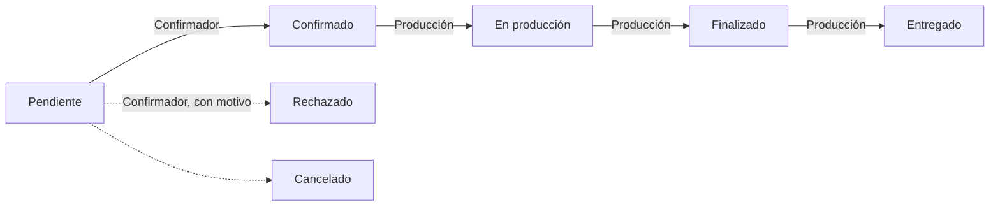

# ConexBase

Sistema web de **pedidos y producción** para *Basecamas y Colchones El
Dormilón* (Fontibón, Bogotá). Sigue un pedido desde que el asesor lo vende
hasta que se entrega al cliente: confirmación, fabricación y tapicería.
Además calcula las comisiones de los asesores.

Antes, la empresa manejaba todo esto por WhatsApp y Excel, con errores de
digitación, datos duplicados y sin saber en qué etapa iba cada pedido.
ConexBase lo centraliza en una sola base de datos.

## ¿Qué estás buscando?

| Quiero… | Ve a |
|---|---|
| Poner el proyecto a funcionar en mi computador | [Instalar con Docker](primeros-pasos/instalacion.md) |
| Saber con qué usuario entrar y qué probar | [Usuarios de prueba](primeros-pasos/usuarios-prueba.md) |
| Entender cómo está construido el sistema | [Arquitectura](arquitectura/index.md) |
| Saber **dónde** hacer un cambio en el código | [¿Dónde hago el cambio?](guias/index.md) |
| Entender **por qué** algo se hizo de cierta forma | [Decisiones (ADR)](decisiones/index.md) |
| Ver las tablas y sus campos | [Base de datos](datos/index.md) |
| Consultar los endpoints y permisos de la API | [API REST](api/index.md) |
| Subir mis cambios al repositorio | [Cómo contribuir](contribuir.md) |

## Tecnologías

| Parte | Tecnología | Carpeta |
|---|---|---|
| Frontend | Angular 21 · TypeScript · Tailwind CSS 4 | `client/` |
| Backend (API REST) | Laravel 12 · PHP 8.3 | raíz del repositorio |
| Base de datos | MySQL | `database/` |
| Entorno | Docker Compose | `docker-compose.yml` |
| Documentación | MkDocs Material (este sitio) y Scribe (API) | `docs/` |

## Roles del sistema

Cada persona entra con un rol y ve solo el menú y las pantallas de ese rol.

| Rol | Qué hace en ConexBase | Pantallas |
|---|---|---|
| **Administrador** | Supervisa todo, gestiona usuarios y ve las comisiones de todos. | Panel General, Ventas, Confirmación, Fabricación, Pedidos del Día, Comisiones de Asesores, Consolidado, Usuarios y Roles |
| **Vendedor** (asesor comercial) | Registra pedidos con su abono y consulta sus comisiones. | Crear Pedido, Mis Pedidos, Mis Comisiones, Ventas Confirmadas, Consolidado, Pedidos del Día |
| **Confirmador** | Revisa los pedidos nuevos y los confirma o rechaza. | Confirmación, Pedidos del Día, Consolidado |
| **Encargado de Producción** | Inicia la fabricación, asigna tapiceros, finaliza y entrega. | Fabricación, Pedidos del Día, Consolidado |
| **Tapicero** | Ve los trabajos que le asignaron y reporta su avance. | Mis Productos |

## Estado del proyecto

| Ya funciona | Pendiente |
|---|---|
| Inicio de sesión con token y permisos por rol | Recuperación de contraseña |
| Ciclo completo del pedido, de Crear a Entregado | Cancelar un pedido desde la aplicación |
| Abonos al crear el pedido | Registrar abonos después de creado el pedido |
| Comisiones de asesores (5 % de lo entregado) | Liquidación por destajo de los tapiceros |
| Reportes: Pedidos del Día y Consolidado (con CSV) | Módulo de finanzas |

Los problemas técnicos conocidos están en
[Riesgos y deuda técnica](arquitectura/11-riesgos.md).

## Equipo

Proyecto académico del **Tecnólogo en Análisis y Desarrollo de Software**
(ficha 3177445), SENA, Centro de Diseño y Metrología, Bogotá.

- Duvan Felipe Sanchez Villamil
- David Sneyder Rodríguez Pulido
- Cristian Camilo Páez Guerrero
- Julian David Gómez Ladino
